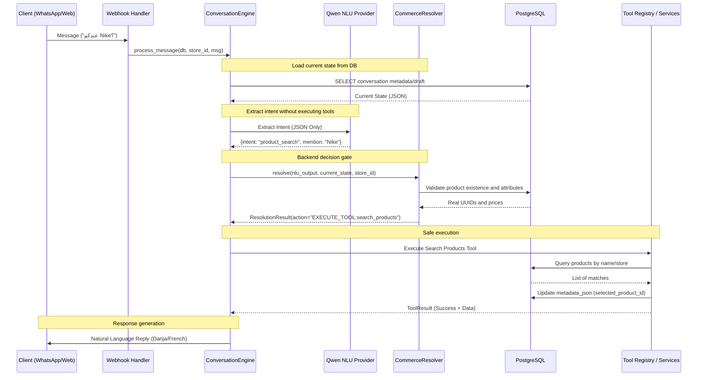

# Project Summary: DzCommerce Backend

## Evidence and scope

This document describes the workspace as inspected on 2026-10-05. It is based on source and configuration files, not assumptions about intended behavior. The repository has no root `README.md` and no root `pyproject.toml`; both are **NOT FOUND**. If a behavior is described by architecture documentation but differs from executable code, this summary calls out the difference.

## 1. Project Overview

DzCommerce is a multi-tenant commerce backend with FastAPI endpoints, SQLAlchemy persistence, product and inventory management, customer conversations, and an AI-assisted sales workflow. The intended users are Algerian merchants who serve customers through social channels, including WhatsApp. Its central commerce-agent design separates language understanding from business decisions: Qwen extracts intent and attributes, `CommerceResolver` chooses an allowed action using conversation state and database lookups, and tools/services execute backend operations using database records as the source of truth.

The current webhook code directly processes Meta Messenger-shaped events at `POST /webhooks/meta`; the `/webhooks/whatsapp` route is a GET verification endpoint, not a WhatsApp message POST handler. WhatsApp adapter modules exist elsewhere under `app/channels/`, but are not the webhook path used by `meta_webhook`.

## 2. Technology Stack

Versions below are the exact pins in `requirements.txt`, not inferred runtime versions.

| Component | Workspace evidence |
|---|---|
| Python | `Dockerfile` uses `python:3.11-slim`. No `requires-python` constraint was found; local runtime version is not declared. |
| FastAPI | `0.115.0` |
| SQLAlchemy | `2.0.35` |
| Alembic | `1.13.2` |
| PostgreSQL | Used through `psycopg2-binary==2.9.9`; server version is not specified in the inspected project files. |
| Pydantic | `2.9.2` via `pydantic[email]`; `pydantic-settings==2.5.2` |
| ASGI server | `uvicorn[standard]==0.30.6` |
| Tests | `pytest==8.3.3`, `pytest-asyncio==0.24.0`, `httpx==0.27.2` |
| Qwen endpoint | `app/core/config.py` defaults to model `qwen-max` and an Alibaba DashScope OpenAI-compatible endpoint. Qwen API key/model/URL/timeout are environment-configured. |
| OpenRouter | No OpenRouter integration/configuration was found in the inspected provider/config files. The provider actually inspected is DashScope-backed Qwen. |
| Meta | Meta/Facebook environment variable names are present in `.env.example` and configuration. `POST /webhooks/meta` consumes Meta messaging event-shaped JSON. |
| WhatsApp | WhatsApp Cloud API variable names and adapter modules exist. The inspected webhook module only exposes GET verification at `/webhooks/whatsapp`; no WhatsApp POST message route is implemented there. |

**Dependency caveat:** `app/agent/providers/qwen_provider.py` imports the `openai` package, but `openai` is not listed in the inspected `requirements.txt`. A clean install from that manifest may therefore fail when importing the Qwen provider unless the dependency is supplied separately.

## 3. Directory Structure

This is a concise tree of existing project source/configuration areas, excluding virtual environments, caches, and generated frontend dependencies.

```text
backend/
├── app/
│   ├── agent/
│   │   ├── providers/
│   │   └── tools/
│   ├── api/
│   ├── channels/
│   │   └── adapters/
│   ├── core/
│   ├── models/
│   ├── schemas/
│   └── services/
├── alembic/
│   └── versions/
├── docs/
├── frontend/
├── migrations/
├── scripts/
└── tests/
```

Top-level source areas:

- `app/`: FastAPI application, agent workflow, API routers, SQLAlchemy models, channel adapters, schemas, and services.
- `alembic/`: Alembic environment and versioned migrations.
- `migrations/`: A separate existing directory; its relationship to `alembic/` is not established by the files inspected here.
- `docs/`: Includes `architecture_phase13.md` and this summary.
- `frontend/`: Existing frontend application; its implementation is outside this backend summary.
- `scripts/`: Development/probe scripts, including the Phase 13 flow probe.
- `tests/`: Pytest test suite.

Selected root files that exist: `Dockerfile`, `alembic.ini`, `requirements.txt`, `pytest.ini`, `.env.example`, `seed_data.py`, and several phase/setup scripts. Root `README.md` is **NOT FOUND**.

## 4. Architecture Overview

The documented principle in `docs/architecture_phase13.md` is: **“Qwen understands, Backend decides, Database proves.”** The intended Phase 13/14 flow is:

1. `ConversationEngine.process_message` loads conversation state and draft.
2. `_extract_nlu_via_qwen` requests structured intent/attribute JSON without tool execution.
3. `CommerceResolver.resolve` uses current state and tenant-filtered database lookups to select an allowed action and resolved entities.
4. The engine executes an approved registered tool, an internal service call, or returns a text-only hint.
5. Conversation metadata/draft changes are persisted.

The architecture document contains this Mermaid sequence diagram. Its checked-in diagram ends after the response-generation message and does not include an explicit sequence/code-fence terminator in the inspected content.



### Runtime assembly

- `app/main.py` creates `FastAPI(title="DzCommerce Agent API", version="0.12.0")`, installs permissive CORS, includes API routers, and registers `SearchProductsTool` into the imported global `tool_registry` if absent.
- `app/api/agent.py` builds a new `ToolRegistry` per chat request and registers a larger tool set. Its provider is selected by `AGENT_PROVIDER`, defaulting to `mock`; `qwen` selects `QwenLLMProvider`.
- `app/api/webhooks.py` creates a module-level engine with the `AGENT_PROVIDER` text provider, the global `tool_registry`, and an optional OpenAI-compatible vision provider.
- `app/database.py` creates the SQLAlchemy engine from `settings.DATABASE_URL`; `get_db()` yields and closes a `SessionLocal` session.

### Conversation continuity and Messenger image understanding

- Conversation working memory is stored in `Conversation.metadata_json`; product and variant selections remain database-backed references, and the active draft remains in `active_draft_json`. Newly created active drafts have a stable `draft_id`; existing JSON drafts are not rewritten just to add one.
- Messenger image attachments are analyzed only after they have been validated and stored locally. Configure `VISION_API_KEY`, `VISION_BASE_URL`, and `VISION_MODEL` to use an OpenAI-compatible vision-capable model. Without all three values, image handling remains graceful and asks the customer to describe the image.
- Vision output is persisted as an unverified visual observation. Product identity, price, inventory, order state, and customer consent must still come from the catalog, database, or explicit customer input.

## 5. Core Components

### 5.1 Webhook Layer (`app/api/webhooks.py`)

Routes:

- `POST /webhooks/meta` — parses Meta-style `entry[].messaging[]` events, requires a sender ID and accepts text or supported image attachments, locates the active store bound to the Meta account, and finds/creates a `Customer` and active `Conversation`.
- `GET /webhooks/meta` and `GET /webhooks/whatsapp` — verify a subscription using `hub.mode`, `hub.verify_token`, and `hub.challenge`. The default token is `dzcommerce_test_2026`; `FACEBOOK_VERIFY_TOKEN` may override it.

Idempotency:

- Uses `Message.external_message_id` (`mid`) as the deduplication key.
- First queries for an existing message. If absent, attempts an insert and immediate `db.commit()`.
- The model column is unique, so a concurrent duplicate causes `IntegrityError`; the handler rolls back and skips AI processing.
- Duplicate events skip engine execution. Events without an external message ID are processed without deduplication.
- User input, engine output, and bot reply are persisted as `Message` records. Failures use rollback/recovery logic and a fixed Arabic fallback.

Store resolution in this handler chooses the first `Store.is_active == True`; it does not resolve a store from the incoming event payload.

### 5.2 Conversation Engine (`app/agent/conversation_engine.py`)

Key signatures:

- `ConversationEngine.__init__(self, llm_provider, tool_registry: ToolRegistry)`
- `ConversationEngine._normalize_current_state(conversation: Conversation, store_id: uuid.UUID) -> dict`
- `async ConversationEngine.process_message(self, db: Session, store_id: uuid.UUID, customer_id: uuid.UUID, conversation_id: uuid.UUID | None, channel: str, user_message: str) -> dict`
- `async ConversationEngine._extract_nlu_via_qwen(self, message: str, state: dict) -> dict`
- `ConversationEngine._heuristic_nlu(self, message: str) -> dict`
- `ConversationEngine._prepare_safe_tool_args(self, tool_name: str, resolved_data: dict, nlu_output: dict) -> dict`
- `async ConversationEngine._generate_final_text(self, tool_result_data: dict, hint: str, original_msg: str) -> str`
- `async ConversationEngine._handle_service_call(self, service_name: str, data: dict, db: Session, conv_id: uuid.UUID) -> str`

`process_message` creates a conversation when needed, loads normalized flat state, extracts NLU, invokes `CommerceResolver`, and dispatches the resolver's `EXECUTE_TOOL:*`, `CALL_SERVICE:*`, or `RESPOND:text_only` action. It merges resolver context updates and commits the main session. Tool calls are returned as an empty compatibility list in the current implementation.

`_normalize_current_state` exposes `store_id`, `commerce_stage`, selected product/variant IDs and names, candidate IDs, selected attributes, `variant_index_map`, and `active_draft_json` as top-level keys. It has legacy fallbacks to `last_product_id` and `last_product_name`.

`_handle_service_call` currently handles `create_draft` and `resolve_variant`. The variant response uses resolver-provided `price` and `stock`; unhandled service names return a “Not implemented in Phase 14.1-A” message.

### 5.3 Commerce Resolver (`app/agent/commerce_resolver.py`)

Types:

- `CommerceStage(str, Enum)`
- `AllowedAction(str, Enum)`
- `ResolutionResult` dataclass: `allowed_action: str`, `resolved_entities: dict[str, Any]`, `context_updates: dict[str, Any]`, `response_hint: str`
- `CommerceResolver(db: Session)` with `resolve(nlu_output: dict[str, Any], current_state: dict[str, Any], store_id: uuid.UUID) -> ResolutionResult`

Stages:

- `EMPTY`
- `PRODUCT_CANDIDATES`
- `PRODUCT_SELECTED`
- `VARIANT_SELECTED`
- `DRAFT_PENDING`
- `ORDER_CONFIRMED`

Allowed action values declared in the enum:

- `EXECUTE_TOOL:search_products`
- `EXECUTE_TOOL:get_product_details`
- `CALL_SERVICE:create_draft`
- `CALL_SERVICE:update_draft`
- `EXECUTE_TOOL:confirm_order`
- `CALL_SERVICE:resolve_variant`
- `RESPOND:text_only` (used by clarification, re-search/switch, block, already-confirmed, no-draft, and list-candidate enum names)
- `CALL_SERVICE:update_selection`

Decision matrix implemented:

| Current stage | Relevant intent | Resolver decision |
|---|---|---|
| `EMPTY` | `product_search` with a product mention | Search products |
| `EMPTY` | Other | Ask for clarification |
| `PRODUCT_CANDIDATES` | `variant_selection` or `order_create` | Ask the customer to choose a product |
| `PRODUCT_CANDIDATES` | `product_search` | Search again |
| `PRODUCT_SELECTED` | `variant_selection` | Match variant by attributes/name; return `resolve_variant` with DB variant UUID, price, and stock, or show details if no match |
| `PRODUCT_SELECTED` | `order_create` | Create draft if a variant is selected; otherwise show product details |
| `PRODUCT_SELECTED` | `product_search` | Ask whether to switch products |
| `VARIANT_SELECTED` | `order_create` | Validate DB variant and stock, then create draft |
| `VARIANT_SELECTED` | `variant_selection` | Return `update_selection` |
| `VARIANT_SELECTED` | `order_confirm` | Reject because there is no draft |
| `DRAFT_PENDING` | `order_confirm` | Execute `confirm_order` |
| `DRAFT_PENDING` | `order_create` | Return `update_draft` |
| `DRAFT_PENDING` | `product_search` | Block and ask to confirm/cancel first |
| `ORDER_CONFIRMED` | Any | Return already-confirmed information |

Stage detection in `_get_current_stage_from_db` uses state facts in this order: non-empty draft items, selected variant, candidates without a selected product, selected product, otherwise empty. Variant lookup filters by `store_id`, product ID, and active product; it checks `attributes_json` if available, otherwise matches requested attribute values in `ProductVariant.name`. Price is product base price plus variant adjustment. Stock lookup filters `InventoryItem` by `store_id` and `variant_id`.

### 5.4 Tools (`app/agent/tools/*.py`)

The listed input schemas and persistence behavior come from the inspected tool files.

| Tool class / registered name | Purpose and input schema | Persistence / behavior |
|---|---|---|
| `SearchProductsTool` / `search_products` | Required `query: string` | Queries active products by `store_id` and name, limit 5. If one result and a conversation is supplied, writes `selected_product_id`, `selected_product_name`, `commerce_stage=PRODUCT_SELECTED`, and clears stale candidate/variant fields. Multiple results persist candidate IDs and `PRODUCT_CANDIDATES`. Commits these metadata changes. |
| `GetProductDetailsTool` / `get_product_details` | Optional `product_id: string` | Tenant-filters product; returns variant index/name/attributes/price/stock; saves `variant_index_map`, `last_product_id`, and `last_product_name` into conversation metadata and flushes. |
| `CreateOrderDraftTool` / `create_order_draft` | Required `items: [{variant_index: integer, quantity: integer}]`; optional `shipping_info: object` | Calls `save_draft_safe` in a nested transaction/savepoint, using the current session. Persists `active_draft_json`; does not deduct stock. |
| `ConfirmOrderTool` / `confirm_order` | Empty object; no required arguments | Locks conversation, reads active draft, fetches authoritative product/variant data, deducts stock, creates `Order` and `OrderItem` rows, clears active draft, and commits. Empty draft returns a successful already-confirmed-style result. |

The package `app/agent/tools/__init__.py` auto-registers `SearchProductsTool`, `GetProductDetailsTool`, `CheckInventoryTool`, `CreateOrderDraftTool`, `UpdateOrderDraftTool`, and `ConfirmOrderTool` in a global registry. `app/api/agent.py` separately registers additional tools for the authenticated chat endpoint.

### 5.5 Services (`app/services/*.py`)

#### `order_draft_service.py`

Public functions:

- `get_current_draft(db: Session, conversation_id: uuid.UUID) -> dict | None`
- `save_draft_safe(db: Session, conversation_id: uuid.UUID, store_id: uuid.UUID, items: list[dict], shipping_info: dict | None = None) -> dict`
- `save_draft(db: Session, conversation_id: uuid.UUID, items: list[dict], shipping_info: dict | None = None, store_id: uuid.UUID | None = None) -> dict`
- `clear_draft(db: Session, conversation_id: uuid.UUID) -> None`

`save_draft_safe` resolves `variant_index` through conversation metadata, validates variant ownership against the supplied `store_id`, computes price from the product, checks inventory availability, and stores the draft in `Conversation.active_draft_json`. Draft creation does not deduct stock. Existing identical one-item drafts are treated idempotently; a different one-item draft raises `ValidationError` rather than silently replacing it. The legacy `save_draft` wrapper derives the store from the conversation if necessary and forwards items to `save_draft_safe`.

#### `inventory_service.py`

- `get_inventory_by_variant(db, store_id, variant_id, for_update=False) -> InventoryItem | None`
- `get_available_quantity(db, store_id, variant_id) -> int`
- `deduct_stock(db, store_id, variant_id, quantity) -> InventoryItem`
- `restore_stock(db, store_id, variant_id, quantity) -> InventoryItem`

Reads and writes are scoped by store and variant. `for_update=True` uses a row lock. Deduction rejects non-positive quantities, missing inventory, and insufficient stock, then flushes; callers control transaction commit/rollback.

#### `exceptions.py`

Defines `ServiceError`, `NotFoundError`, `DuplicateSKUError`, `ValidationError`, `OrderStateError`, `InsufficientInventoryError`, and `OrderNotModifiableError`.

### 5.6 Models (`app/models/*.py`)

| Class | Table | Key fields / relationships |
|---|---|---|
| `Conversation` | `conversations` | `id`, `store_id`, `customer_id`, `channel`, string `status`, `external_conversation_id`, nullable JSON `active_draft_json`, nullable JSON `metadata_json`, timestamps; `messages` relationship. `metadata_json` and `active_draft_json` use SQLAlchemy `MutableDict`. |
| `Message` | `messages` | `id`, `conversation_id`, string `role`, `content`, optional `message_type`, unique nullable `external_message_id`, optional JSON `metadata_json`, `created_at`; relationship to conversation. |
| `Product` | `products` | `id`, `store_id`, `name`, optional `description`/`sku`, `base_price`, `is_active`, timestamps; `variants` relationship. |
| `ProductVariant` | `product_variants` | `id`, `product_id`, `name`, optional `sku`, `price_adjustment`, `created_at`; product and one-to-one `inventory_item` relationships. No declared `attributes_json` mapped column in the inspected model. |
| `InventoryItem` | `inventory_items` | `id`, `store_id`, unique `variant_id`, `quantity`, `low_stock_threshold`, `updated_at`; relationship to variant. |
| `Customer` | `customers` | `id`, `store_id`, `name`, optional `email`/`phone`, optional unique `facebook_id`/`whatsapp_id`, timestamps. |
| `Store` | `stores` | `id`, `name`, unique/indexed `slug`, `is_active`, timestamps; `user_links` relationship. |
| `Order` | `orders` | Exact columns below; `items` relationship. |
| `OrderItem` | `order_items` | Exact columns below; relationship to order. |

**Exact `Order` columns:** `id`, `store_id`, `customer_id`, `conversation_id`, `status`, `subtotal`, `shipping_cost`, `total`, `shipping_address`, `wilaya`, `created_at`, `updated_at`.

**Exact `OrderItem` columns:** `id`, `order_id`, `product_id`, `variant_id`, `quantity`, `unit_price`.

`Order.status` uses `OrderStatus`: `DRAFT`, `WAITING_CONFIRMATION`, `CONFIRMED`, `READY_TO_SHIP`, `SHIPPED`, `DELIVERED`, `CANCELLED`, `HUMAN_HANDOFF`. `shipping_address` is nullable `Text`; the confirm tool serializes shipping info as JSON text. No `notes` or `line_total` columns exist on these order models.

## 6. Data Contracts

The JSON columns are flexible JSON dictionaries, not database-enforced JSON Schemas. The following reflects fields read/written in the inspected code; it is not a claim that every key is always present.

### `Conversation.metadata_json`

Common/current keys:

```json
{
  "commerce_stage": "EMPTY | PRODUCT_CANDIDATES | PRODUCT_SELECTED | VARIANT_SELECTED | DRAFT_PENDING | ORDER_CONFIRMED",
  "selected_product_id": "UUID string or null",
  "selected_product_name": "string or null",
  "candidate_product_ids": ["UUID string"],
  "selected_variant_id": "UUID string or null",
  "selected_attributes": {"color": "black", "size": "42"},
  "variant_index_map": {"1": "UUID string"},
  "last_product_id": "UUID string",
  "last_product_name": "string",
  "last_intent": "intent string",
  "last_nlu": {
    "intent": "product_search",
    "intent_guess": "product_search",
    "product_mention": "Nike",
    "attributes": {},
    "quantity": null,
    "confirmation_phrase": false,
    "language": "ar",
    "confidence": 1.0
  }
}
```

The `last_product_*` keys support older context paths. `GetProductDetailsTool` also reads `last_searched_product.id` as a fallback, while the current search tool writes canonical `selected_product_id`; see known issues.

### `Conversation.active_draft_json`

`save_draft_safe` writes a structure with this shape:

```json
{
  "items": [
    {
      "variant_id": "UUID string",
      "product_name": "string",
      "variant_name": "string",
      "unit_price": 8500.0,
      "quantity": 1,
      "line_total": 8500.0,
      "available_stock": 10
    }
  ],
  "shipping_info": {},
  "total_price": 8500.0,
  "currency": "DZD",
  "updated_at": "ISO-8601 timestamp"
}
```

The column is nullable and is set to `None` by `clear_draft` and successful confirmation.

### NLU output

The engine's prompt requests JSON with:

```json
{
  "intent": "product_search | variant_selection | order_create | order_confirm | greeting | unknown",
  "product_mention": "string or null",
  "attributes": {"key": "value"},
  "quantity": "integer or null",
  "confirmation_phrase": "boolean",
  "language": "ar | fr | en",
  "confidence": 0.0
}
```

The parser also accepts/sets `intent_guess`; a heuristic fallback may produce it. Qwen is explicitly instructed not to emit product/variant/order IDs, price, or stock.

### `ResolutionResult`

Python dataclass fields (not a JSON serialization contract):

```json
{
  "allowed_action": "string enum value",
  "resolved_entities": {},
  "context_updates": {},
  "response_hint": "string"
}
```

For variant resolution, `resolved_entities` contains `product_id`, `variant_id`, `price`, and `stock`. For draft creation it contains `product_id`, `variant_id`, `quantity`, `unit_price`, and `total_price`.

## 7. Current State of Development

The checked-in documentation describes Phase 13 and transition to Phase 14. The workspace does not include a canonical phase-completion tracker, so phase status below is evidence-based, not a formal release declaration.

| Area | Status | Evidence |
|---|---|---|
| Multi-tenant product/inventory/order backend | Implemented baseline | Models, services, API routers, and tests exist. |
| Conversation persistence and webhook duplicate handling | Implemented | `Message.external_message_id` is unique; handler uses insert/commit and race-conflict rollback. |
| Phase 13 draft/order flow | Implemented and probed | `phase13_real_flow_probe.py` checks search state, variant, draft, confirmation, and duplicate confirmation in a disposable schema. |
| Phase 14 resolver-driven NLU/business separation | In progress | Resolver, NLU parser, state normalization, and dispatch exist; some declared resolver actions lack service implementations. |
| Phase 15 dashboard | Not present in inspected backend phase docs | A future recommendation, not an existing phase implementation. |
| Phase 16 CRM | Not present as a named completed phase | Customer context, COD, follow-up, and lost-sales components do exist, but a formal Phase 16 designation was not found. |
| Phase 17 payment integration | Not present in inspected files | No payment provider integration appears in the requested files. |

### Probe/test evidence

- The latest recorded local webhook simulation in the preceding task used a disposable PostgreSQL schema and deterministic NLU. It reported: Step 1 selected a Nike product and set `PRODUCT_SELECTED`; Step 2 saved the Black/Size 42 variant without a second search; Step 3 created a one-item draft while inventory stayed at 10; Step 4 confirmed one order, cleared the draft, set `ORDER_CONFIRMED`, and reduced isolated inventory to 9. The temporary schema was dropped.
- That webhook simulation's Step 2 reply was the old `resolve_variant` placeholder. `_handle_service_call` has since been updated to return a Darija response with resolver-provided price and stock, but the recorded webhook simulation was not rerun after that response change.
- The checked-in `scripts/phase13_real_flow_probe.py` uses a temporary PostgreSQL schema, copies real store/product/variant/customer/inventory records into it, swaps the registry session factory, executes the flow, and drops the schema in `finally`. In the script, Step 1 calls `SearchProductsTool.execute` directly; Steps 2–5 use `ConversationEngine.process_message`. Therefore, the checked-in probe is not a full four-message webhook test.
- Pytest configuration points at `tests/` and project root. Test modules currently include auth, products, inventory, multi-tenancy, tool registry/tools, order service, multi-turn, customer context, channel foundation, store membership, and COD/lost sales. No coverage report was inspected.

## 8. Known Issues & Technical Debt

Line numbers below refer to the inspected source revision.

1. **Resolver-declared actions are not all handled by the engine.** `CommerceResolver` can return `CALL_SERVICE:update_draft` and `CALL_SERVICE:update_selection`; `_handle_service_call` handles `create_draft` and `resolve_variant` only, then falls through to a “Not implemented” response. See `app/agent/commerce_resolver.py:176-205` and `app/agent/conversation_engine.py:400-497`.
2. **Confirmed-stage inference can disagree with persisted selection facts.** `_get_current_stage_from_db` checks active draft, variant, candidates, and selected product, but not confirmed order records or `ORDER_CONFIRMED` metadata. After the draft is cleared, retained selected-variant metadata can cause the inferred stage to be `VARIANT_SELECTED`, despite confirmation context metadata. See `app/agent/commerce_resolver.py:249-268`; the enum/decision branch is at `app/agent/commerce_resolver.py:17-24, 237-244`.
3. **Legacy product fallback key mismatch.** `GetProductDetailsTool` fallback reads `metadata_json["last_searched_product"]["id"]` at `app/agent/tools/get_product_details.py:84`; the current `SearchProductsTool` writes `selected_product_id` and `selected_product_name` at `app/agent/tools/search_products.py:76-85`. Normal resolver dispatch supplies an explicit product ID in common paths, but the fallback itself does not match the current search write contract.
4. **Variant detail inventory lookup omits `store_id`.** `GetProductDetailsTool` outer-joins `InventoryItem` by variant ID and filters the product by tenant, but does not add `InventoryItem.store_id` to the stock join/filter. See `app/agent/tools/get_product_details.py:111-123`. The inventory service and confirmation path do apply tenant scope.
5. **Variant price adjustments are inconsistent in draft/confirmation.** The resolver's `_get_price_for_variant` adds `price_adjustment` (`app/agent/commerce_resolver.py:367-370`), while `save_draft_safe` calculates unit price from `variant.product.base_price` (`app/services/order_draft_service.py:140-146`) and `ConfirmOrderTool` recalculates from `product.base_price` (`app/agent/tools/confirm_order.py:111-114`). Variants with a nonzero adjustment may therefore have mismatched displayed, drafted, and confirmed prices.
6. **Qwen dependency is absent from the pinned requirements list.** The provider imports `openai`, but `requirements.txt` contains no `openai` package pin. See `app/agent/providers/qwen_provider.py:7` and `requirements.txt`.
7. **WhatsApp message ingress is not wired in the inspected webhook router.** `/webhooks/whatsapp` is registered only for GET verification; message POST handling is at `/webhooks/meta` and sets channel `"facebook"`. See `app/api/webhooks.py:28-29, 213-215`.
8. **The isolated flow probe only directly exercises product search for Step 1.** It does not verify the complete HTTP webhook path in the checked-in script. See `scripts/phase13_real_flow_probe.py:267-300` and `:356-390`.

No `TODO` or `FIXME` matches were found in the inspected `app/`, `scripts/`, or `docs/` directories.

## 9. Testing Strategy

### Run the test suite

Install the pinned dependencies and run pytest from the backend root:

```powershell
python -m pip install -r requirements.txt
python -m pytest
```

`pytest.ini` sets `pythonpath = .` and `testpaths = tests`.

### Run the Phase 13 real-flow probe

```powershell
python scripts/phase13_real_flow_probe.py
```

The probe relies on configured PostgreSQL access and a suitable existing Nike product with a Black/42 variant plus a customer/inventory record. It creates a uniquely named temporary schema, copies only the fixture rows needed into that schema, runs state/order checks there, then drops the schema in `finally`. It temporarily substitutes the registry's `SessionLocal` with the probe session factory so tools target the disposable schema.

### Coverage gaps

- The checked-in probe does not send all four customer messages through the HTTP webhook.
- The recorded webhook run predates the latest `resolve_variant` response change; retest the user-visible Step 2 reply.
- A dedicated resolver decision-matrix test and explicit nonzero `price_adjustment` consistency test were not identified in the requested files.
- PostgreSQL server version and automated CI coverage configuration were not identified in the inspected files.

## 10. Next Steps (Recommended)

These are recommendations, not existing implemented features.

### Phase 15: Dashboard

- Merchant workspace and store-level access control.
- Product/variant/inventory management.
- Orders, status transitions, fulfillment, and order detail views.
- Conversation inbox with handoff and customer context.
- Sales, inventory, and agent-usage analytics backed by existing stats/API data.

### Phase 16: CRM features

- Unified customer timeline across channels.
- Searchable customer profiles, segments, notes, and consent-aware communication preferences.
- Follow-up scheduling and status tracking; connect existing sales opportunity and customer-context components.
- Tenant-scoped CRM reporting and audit history.

### Phase 17: Payment integration

- Select a supported provider and define payment lifecycle/state transitions before implementation.
- Persist provider references and verified webhook events; do not trust client-supplied payment status.
- Make payment callbacks idempotent and tenant-scoped.
- Keep COD and online payment reconciliation distinct; add sandbox integration tests.

### Cross-cutting optimization

- Implement or remove resolver actions that currently fall through.
- Normalize product/variant price calculation into one authoritative service path.
- Add end-to-end webhook tests using disposable database schemas.
- Make provider dependencies and environment variables explicit in manifests/example config.
- Add structured logs and metrics for NLU, resolver decisions, tool outcomes, webhook duplicates, and inventory conflicts.

## 11. Key Files Index

Status is an operational summary, not a formal stability guarantee.

| File Path | Purpose | Status | Notes |
|---|---|---|---|
| `app/main.py` | FastAPI app and router/tool startup wiring | In progress | App version is `0.12.0`. |
| `app/database.py` | SQLAlchemy engine/session/Base | Stable | Reads `settings.DATABASE_URL`. |
| `app/api/webhooks.py` | Meta webhook processing and verification | In progress | Meta POST; GET verification for Meta and WhatsApp. |
| `app/api/agent.py` | Authenticated agent chat endpoint | In progress | Builds per-request registry/provider. |
| `app/models/conversation.py` | Conversation/message persistence | Stable | Mutable JSON context and unique external message ID. |
| `app/models/product.py` | Product and variant models | Stable | Variant attributes represented by fields such as `name`; no mapped `attributes_json`. |
| `app/models/order.py` | Order and order-item schema | Stable | Exact columns listed in section 5.6. |
| `app/models/inventory.py` | Variant stock table | Stable | Unique variant inventory row. |
| `app/models/customer.py` | Store-scoped customer profile | Stable | External channel ID fields are present. |
| `app/models/store.py` | Store/tenant model | Stable | Has active flag and user relationship. |
| `app/agent/conversation_engine.py` | NLU orchestration, resolver dispatch, responses | In progress | Service action coverage incomplete. |
| `app/agent/commerce_resolver.py` | State-based action gate and DB entity resolution | In progress | Some actions are declared but not wired. |
| `app/agent/context_builder.py` | Prompt, state summary, and recent history builder | In progress | Current engine NLU path does not use this builder. |
| `app/agent/providers/base.py` | LLM message/provider/response contracts | Stable | Abstract async `chat` interface. |
| `app/agent/providers/qwen_provider.py` | OpenAI-compatible Qwen transport | In progress | Configured for DashScope; dependency pin missing from requirements. |
| `app/agent/tools/registry.py` | Tool registration and isolated-session execution | In progress | Creates a fresh session per tool call. |
| `app/agent/tools/search_products.py` | Tenant-scoped product search and selection persistence | In progress | Single-result auto-select; commits metadata. |
| `app/agent/tools/get_product_details.py` | Variant list and index mapping | In progress | Legacy fallback key and stock tenant filter need review. |
| `app/agent/tools/create_order_draft.py` | Draft tool wrapper | In progress | Uses variant index and `save_draft_safe`. |
| `app/agent/tools/confirm_order.py` | Confirmation, stock deduction, and order creation | In progress | Atomic DB transaction path; price adjustment consistency needs review. |
| `app/services/order_draft_service.py` | Draft validation and persistence | In progress | Does not deduct stock; uses base price. |
| `app/services/inventory_service.py` | Tenant-scoped inventory access/mutation | Stable | `deduct_stock` supports locking and validation. |
| `app/services/exceptions.py` | Business exception classes | Stable | Shared service exceptions. |
| `scripts/phase13_real_flow_probe.py` | Disposable-schema order-flow probe | In progress | Step 1 is direct tool execution, not a webhook request. |
| `docs/architecture_phase13.md` | Phase 13/14 architecture notes | In progress | Diagram ends without explicit terminator. |
| `requirements.txt` | Pinned Python dependencies | In progress | Does not pin the imported `openai` dependency. |
| `alembic.ini` | Alembic configuration | Stable | Uses `alembic` as script location. |
| `README.md` | Project onboarding document | NOT FOUND | No root README was present. |
| `pyproject.toml` | Python project metadata/alternate dependencies | NOT FOUND | `requirements.txt` is the dependency manifest. |

## 12. Environment Setup

### Dependencies

Use Python 3.11 to match the checked-in Dockerfile. From the backend root:

```powershell
python -m venv .venv
.\.venv\Scripts\Activate.ps1
python -m pip install --upgrade pip
python -m pip install -r requirements.txt
```

Before using the Qwen provider, ensure the `openai` package dependency is installed and recorded in the project manifest; it is imported by `qwen_provider.py` but not currently pinned in `requirements.txt`.

### PostgreSQL and environment

Install/run PostgreSQL separately; this workspace does not pin or document a server version. Create a database and configure `DATABASE_URL` for the application. The connection must be accessible to the application and Alembic. `.env.example` lists database, JWT, Meta, and WhatsApp variable names; do not commit populated secrets. `app/core/config.py` additionally reads `AGENT_PROVIDER`, `QWEN_API_KEY`, `QWEN_MODEL`, `QWEN_BASE_URL`, `QWEN_TIMEOUT`, and Facebook variables. These Qwen variables are not listed in `.env.example`.

### Migrations

With database configuration in place:

```powershell
alembic upgrade head
```

`alembic.ini` points to `alembic/`; confirm `alembic/env.py` uses the same configured database URL before applying migrations in a new environment.

### Start the API

```powershell
uvicorn app.main:app --reload
```

The Dockerfile uses the same ASGI target and port `8000`.

### Run the flow probe

```powershell
python scripts/phase13_real_flow_probe.py
```

Use a non-production database with permissions to create/drop schemas. The script is designed to create and clean up its own temporary schema; inspect its final step report and cleanup message.

## Verification

- [x] Files used for this summary were checked in the workspace; root `README.md` and `pyproject.toml` are explicitly marked **NOT FOUND**.
- [x] The classes/functions named above were cross-checked against source declarations.
- [x] JSON examples reflect keys constructed or consumed by current code and are labeled as flexible observed contracts, not rigid schema constraints.
- [x] No `[TODO]` or `[INSERT HERE]` placeholder text was added.
- [x] TODO/FIXME search in `app/`, `scripts/`, and `docs/` found no matches.
